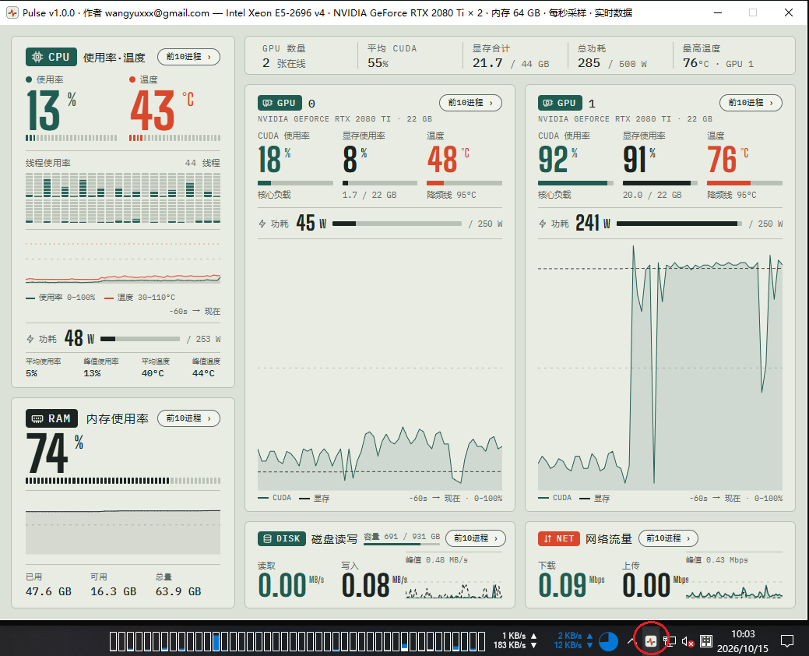

**简体中文** | [English](README.en.md)

# Pulse

Windows 硬件监控小工具。跑本地 AI 的时候，最该盯着的就是这台机器：显存还剩多少、显卡有没有
因为温度撞墙降频、CPU 和内存是不是瓶颈。可这些数据散在好几个地方 —— 任务管理器看得到占用率，
看不到显卡温度；显卡的温度和功耗要开 LibreHardwareMonitor，在那棵传感树里一层层翻；
`nvidia-smi` 又得开命令行。来回切窗口不说，几个界面上的数还不是同一时刻的，对不上。

Pulse 把该看的整合到一屏：CPU、每张显卡、内存、磁盘、网络的占用率 / 温度 / 功耗 / 显存，
点一下面板还能看这一项的前 10 进程。界面用 pywebview 渲染 HTML，**常驻系统托盘 —— 鼠标移到
托盘图标上窗口立刻弹出来，移开就自动收起**，不用切窗口，瞄一眼就收。



## 依赖

显卡的状态 Pulse 自己读不到，全靠这两个外部程序：

| 要监控什么 | 靠谁 |
|---|---|
| GPU 的占用率 / 温度 / 功耗 | [LibreHardwareMonitor](https://github.com/LibreHardwareMonitor/LibreHardwareMonitor) 的 Web 服务（`localhost:8085`） |
| GPU 的编号顺序、功耗上限 | `nvidia-smi`（随 NVIDIA 驱动安装） |
| GPU 已用显存 | Windows 的 `GPU Adapter Memory` 计数器 |
| CPU 温度 / 封装功耗 | LibreHardwareMonitor |
| 网络前 10 进程排行 | ETW 内核日志（`pywintrace`） |

- **LibreHardwareMonitor**：独立的 .NET 程序，不是 Python 库 —— 温度、功耗都问它。分发包里带了
  一份，没装也能跑，只是温度那几格空着（GPU 温度退回 `nvidia-smi` 报的值）。它是
  `requireAdministrator`，由 Pulse 拉起时必然弹一次 UAC。
- **`nvidia-smi`**：随 NVIDIA 驱动装，不用单独准备。机器上没有 NVIDIA 显卡或驱动时，
  GPU 面板就没有数据。
- **管理员权限**：网络排行靠 ETW，非管理员启动时那一项是空的（托盘会提醒，菜单里可一键提权重启）。

GPU 的数值和编号为什么来自两个来源、显存为什么又绕开它们，见 `pulse.py` 里 `_pair_gpus` 和
`_AdapterMem` 的注释。

## 跑起来

需要 Python 3.10+ 和 Windows 10/11（依赖 WebView2 运行时，Win11 和较新的 Win10 自带）。

```cmd
pip install pywebview psutil pywintrace pystray pillow
python pulse.py
```

**启动时窗口是隐藏的**，只进托盘 —— 鼠标移到图标上就弹出来，移开就收。点图标也能手动显示 /
收起，菜单里还有「显示窗口」。关窗口只是收回托盘，采样继续；窗口就摆在托盘图标旁边（工作区
右下角）。`--tray` 给开机自启用：一样隐藏启动，另外不发气泡提醒。

## 打包成单文件 exe

```cmd
build.cmd
```

产物在 `dist\`：

| 路径 | 说明 |
|---|---|
| `dist\Pulse.exe` | 单文件，自带 Python 解释器和全部依赖，目标机器不需要装任何东西 |
| `dist\LibreHardwareMonitor\` | 温度传感器。首次启动会问用户要不要装到本机 |

发给用户的是**整个 `dist` 文件夹**，不是一个 exe。

### 准备 LibreHardwareMonitor

`LibreHardwareMonitor/` 是**第三方运行时**，没有提交进仓库（见 `.gitignore`）。
打包前把它放到项目根目录：

1. 从 [LibreHardwareMonitor releases](https://github.com/LibreHardwareMonitor/LibreHardwareMonitor/releases)
   下载发布包并解压到 `LibreHardwareMonitor/`。
2. 删掉 `Aga.Controls.pdb`、`LibreHardwareMonitorLib.pdb`、`LibreHardwareMonitorLib.xml`
   （调试符号，运行时用不到，省 1.4 MB）。
3. **把 `LibreHardwareMonitor.config` 换成精简版**——发布包或你自己机器上那份会带着
   几百个传感器状态 key（`/intelcpu/0/load/2/plot` 之类），那是每台机器学出来的，发给别人只会
   加载一堆不存在的路径：

   ```xml
   <?xml version="1.0" encoding="utf-8"?>
   <configuration>
     <appSettings>
       <add key="runWebServerMenuItem" value="true" />
       <add key="listenerPort" value="8085" />
       <add key="startMinMenuItem" value="true" />
       <add key="minTrayMenuItem" value="true" />
     </appSettings>
   </configuration>
   ```

   `runWebServerMenuItem=true` 就是「启动时自动开 Web 服务」，不需要命令行参数
   （LHM 也不接受任何命令行参数）。
4. 放一份 MPL-2.0 许可证全文为 `LibreHardwareMonitor/LICENSE.txt`——再分发必须随附。

最终约 11 MB。

## 结构

```
pulse.py          入口。采样循环、win32 计数器的 ctypes 封装、注入页面的 pushSample
pulse.html        全部界面。CSS 变量是设计稿的配色，改配色改这里
tray.py           系统托盘：图标、菜单、悬停弹窗、开机自启
lhm.py            LibreHardwareMonitor 的检测 / 安装 / 启动 / 自启
pulse.spec        PyInstaller 配置
build.cmd         打包 = pyinstaller + 拷贝 LHM
backup/           设计稿备份（来自 doop 画布）：frame HTML、2x 截图、元数据
pictures/         README 用的界面截图
```

界面完全由 `pulse.html` 决定，`pulse.py` 只负责每秒采样一次，然后调用页面里的

```js
window.pushSample(usage, temp, gpus, mem, io, power, threads, disk)
```

`None` 表示该项暂无数据。**换设计 = 换 HTML 文件。**

## 许可

本仓库的代码以 MIT 许可发布。

`LibreHardwareMonitor/` 是第三方软件，不属于本仓库，以 **MPL-2.0** 授权。
`Aga.Controls` 等其他 DLL 各有其许可证，再分发时请一并遵守。
